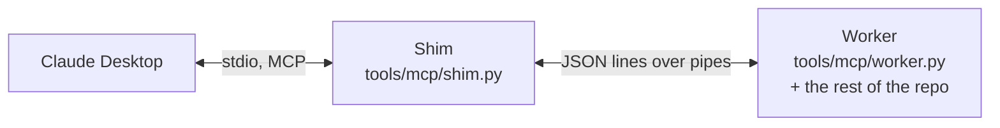

# MCP Server

*Status: implemented in `tools/mcp_server/` ([issue #63](https://github.com/DiscantX/PlanarForgeV2/issues/63)); tested with a fake backend and by speaking the protocol to the shim directly. Not yet tried inside Claude Desktop or against a real game installation.*

The Model Context Protocol (MCP) lets an AI assistant call tools that run on the developer's own machine. PlanarForge would use it so that an assistant, in a Claude Desktop chat, can run the test suite, the [TIS diagnostic](Format-Notes.md#tileset-files-tis-in-biff-archives) and format scans against the installed games and read the results directly, instead of the developer running a command and pasting the output back.

## Constraints

1. **Read-only.** The server never writes into a game installation or the repository. Anything that changes files stays a normal git workflow.
2. **No game assets leave the machine as files, and none are stored.** The [Game Asset Policy](Game-Asset-Policy.md) allows reporting facts about files (names, sizes, offsets, counts) and quoting a few bytes to explain a format. The server enforces that mechanically: byte reads have a small hard cap, and there is no tool that returns a whole resource.
3. **Code changes must not require a restart.** Restarting Claude Desktop or the MCP connection after every edit makes the tool too costly to use during development, which is when it is most useful. The architecture below exists to meet this constraint.

## Architecture: a stable shim and a disposable worker

MCP servers started by Claude Desktop are long-lived processes, and Python caches imported modules, so edited code is not seen until the process restarts. The way out is to split the server in two.



* The **shim** is the process Claude Desktop starts and talks to. It is deliberately small, imports nothing from the repository and nothing outside the standard library, and almost never changes. It implements the few MCP messages a tools-only server needs (`initialize`, `ping`, `tools/list`, `tools/call` and the `tools/list_changed` notification) itself, rather than depending on the MCP SDK, so an SDK upgrade can never break the one file that cannot be hot-reloaded. It owns the MCP connection and keeps it open.
* The **worker** is a child process that imports the repository (`ResourceLoader`, schemas, the diagnostic tools) and does the real work. Because it is a separate process, replacing it picks up every code and schema change.

The shim forwards each tool call to the worker over a pipe, as one JSON object per line. The worker's standard output is reserved for that protocol; its logs go to a file.

### How reloading works

The worker is restarted, never patched in place, in three ways:

* **Automatically on source change.** Before forwarding a call, the shim computes a fingerprint (paths, sizes and modification times) of the repository's `.py` and `.yaml` files. If it differs from the one the running worker started with, the shim restarts the worker first. This also covers `git pull` and branch switches, with no action from the user.
* **On demand.** A `reload` tool restarts the worker explicitly, for the rare case where the fingerprint misses a change.
* **After a crash or a timeout.** If the worker exits, or a call exceeds its time limit, the shim kills the process tree and starts a fresh worker for the next call. The MCP connection is never affected.

A call that is running when a change is detected is allowed to finish (up to its time limit) before the restart. The cost of a restart is the worker's start-up, which includes loading schemas and, on first use per game, reading `CHITIN.KEY`.

### New and changed tools

The worker owns the tool definitions. After every restart the shim asks it for the list and, if it changed, sends the MCP `tools/list_changed` notification so the client can refresh. Whether Claude Desktop acts on that notification has not been verified, so there is a fallback: the shim always exposes two fixed tools, `list_tools` and `call(tool, arguments)`, through which any worker tool is reachable even if the client's tool list is stale. Only the shim's own fixed tools can fail to appear after a change, and the shim is the one file that still needs a restart when it is edited. `status` reports the shim version so a mismatch is visible.

## Tools

| Tool | Purpose | Limits |
|------|---------|--------|
| `status` | Shim and worker versions, worker age and process id, source fingerprint, installed games | none |
| `reload` | Restart the worker | none |
| `list_games` | Games found by `InstallationFinder` and their install paths | none |
| `locate` | Where a resource lives: BIF and locator, or `override/` path, with sizes | one resource per call |
| `describe` | Parsed structure of a resource: header fields, section counts, offsets | summary only; no bulk field dumps |
| `read_bytes` | A hex window of a resource's raw bytes | at most 256 bytes per call |
| `run_diagnostic` | Run a whitelisted repository tool and return its text output | whitelist, timeout, output cap |
| `list_tools`, `call` | Fixed entry points to the worker's tools (see above) | as for the tool called |

`run_diagnostic` runs only tools named in a whitelist kept in the worker: the round-trip suite (`tools/tests/test_suite.py`, tests 1 to 3), `tools/tis_diagnostic.py`, `tools/pvrz_scan.py` and the game-free unit tests. Arguments are passed as a list, never through a shell, and are checked against a per-tool set of allowed flags. Each run has a timeout (default 10 minutes, since the full ARE suite takes minutes) and its output is truncated to a fixed size with a note saying so. Anything not on the whitelist is refused.

## Testing without games

Game-dependent behaviour is tested against a fake loader that serves synthetic resources, so the server's tests run anywhere and no game content enters the repository. The reload mechanism is tested with a fake worker script: change the fingerprint, check the worker was replaced and the connection survived; make the worker crash or hang, check the shim recovers.

## Setup

1. Add the server to Claude Desktop's configuration (`claude_desktop_config.json`, under `mcpServers`), pointing at the shim and the interpreter that has the repository's requirements installed:

   ```json
   {
     "mcpServers": {
       "planarforge": {
         "command": "C:\\path\\to\\python.exe",
         "args": ["C:\\path\\to\\PlanarForgeV2\\tools\\mcp_server\\shim.py"]
       }
     }
   }
   ```

   The shim runs the worker with its own interpreter unless `--python` is given. The repository root defaults to the one the shim lives in.
2. Restart Claude Desktop once. Tools appear in chats started afterwards.
3. Ask for `status` to confirm the worker starts. The worker's log is `logs/mcp-worker.log`.

After that, edits to the repository need no restart. The exception is `shim.py` itself: `status` reports `shim_stale` when it has changed on disk.

## Tests

`tools/tests/test_mcp_server.py` needs no game and runs in a few seconds. It covers the diagnostic whitelist and output cap, the tools against the fake backend, the source fingerprint, worker reuse, restart on change, crash and timeout recovery, a worker that fails to start (reported once, not retried until the sources change), the list-changed callback, and the JSON-RPC protocol against a real shim process.

## Open questions

* Whether Claude Desktop refreshes its tool list on `tools/list_changed` (the fixed `call` tool is the fallback).
* Whether the shim's hand-written protocol handling is accepted by Claude Desktop; it has not been checked against the official SDK client or the app.
* Which Python interpreter the worker should use when the repository has its own virtual environment; likely an option on the shim with a default of the shim's own interpreter.
* Killing a worker's process tree on Windows (`taskkill /T /F` is used; untested there).
* Whether `describe` should reuse the Layer 1 `to_dict()` output or a leaner summary; to be decided once there is a real resource to look at.
